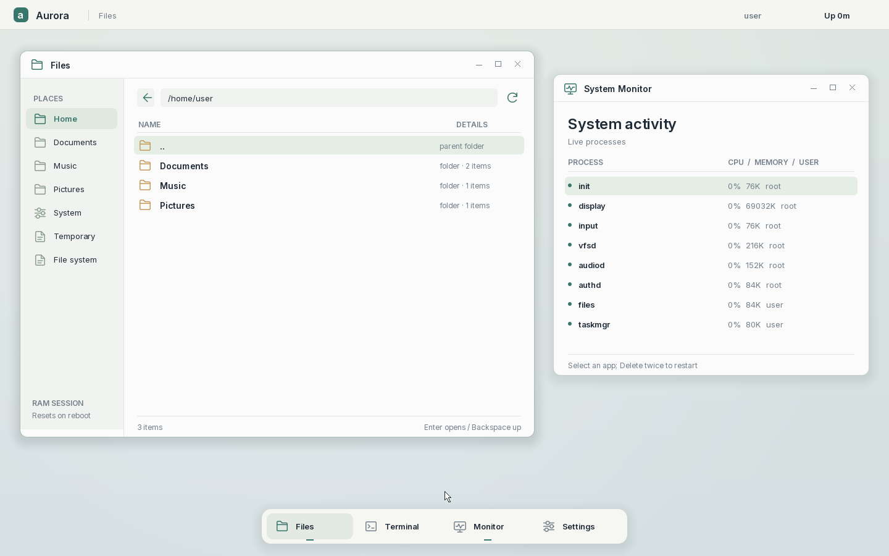

# Aurora OS

Aurora 是一个以微内核为目标的 x86_64 操作系统，目前是 **0.8 开发原型**。内核负责地址空间、调度、受限系统调用和 IPC；桌面、文件服务、终端、任务管理器、输入协议与音频策略运行在独立用户进程。



已将用户程序从内核镜像中拆出，加入用户态 init、显式权限、内存回收、RAM 文件层和终端。已有多用户、文件权限、2×绘制、SVG图标、窗口缩放与显式宿主粘贴。本轮修复启动分辨率反复调整，完成受限二进制读取、一次性I/O授权和真实WAV播放链路。系统设计沿用 Unix/Linux 的成熟语义，并保留微内核方向。现在可以独立构建内核与用户 ELF，但**尚不支持运行中替换整个内核、任意第三方驱动安装或 Linux/POSIX 完整兼容**。

## 使用

```sh
brew install x86_64-elf-gcc limine xorriso qemu
make -j4                   # 独立构建并打包 BIOS/UEFI 混合 ISO
make run                   # 启动前选定分辨率，启动后锁定；macOS默认播放声音
make run RUN_FULLSCREEN=off # 窗口模式，仅缩放视图，不循环改变客体模式
make run RESOLUTION=1920x1080 # 指定启动分辨率
make paste                 # 将宿主复制的单行文本输入客体焦点框，不自动回车
make run AUDIO_BACKEND=none # 静音运行
make resize RESOLUTION=1920x1080 # 手动请求一次显示模式切换
make test                  # 架构边界、ASan/UBSan 解析器、打包器测试
make smoke                 # 含测试模块的 QEMU 集成测试
make graphics-smoke        # 手动模式切换、HiDPI与拖拽光标回归
make audio-smoke           # WAV读取/转换/AC97实际PCM回归
make check                 # 宿主机 + 多用户 + 图形回归
```

首次普通镜像构建会生成本地账号；登录使用 `.local/initial-passwords.txt` 中的密码。root、user、guest 均需密码，推荐日常使用 user。既有账号不会被覆盖。修改密码：`python3 tools/accounts.py --set-password root`，然后 `make iso`。密码文件不进入镜像，只有加盐verifier进入authd的私有启动资源。

Linux 可使用原生 x86_64 GCC：`make CROSS= LIMINE_SHARE=/path/to/limine`。构建需要 Limine 12.x 的宿主工具和启动文件；本机验证版本为 12.9.6。`HOST_CC`、`QEMU`、`LIMINE`、`BUILD_ARCH` 均可覆盖。字体图集已提供；只有重新生成字体才需要 Pillow/fontTools 的 Python 环境。

- **文件**：默认打开当前用户home；侧栏导航、双击/Enter 打开、Backspace 上级、F5 刷新。
- **终端**：F2 打开；`help`、`ls`、`cd`、`pwd`、`cat`、`write <file> <text>`、`mkdir`、`rm`、`ps`、`info`、`caps`、`beep`、`clear`、`id`、`whoami`、`logout`、`stat`、`chmod`、`play`、`audio`、`stop`。当前为 US 键盘布局，不是 POSIX shell。
- **系统监视器**：F4 打开，显示 100 Hz 采样 CPU 占用、私有映射内存、进程属主。选择普通应用后，3 秒内按两次 Delete 可结束并由 init 重启；核心服务受内核保护。
- **窗口**：拖动标题栏、拖动窗口四边/四角改变尺寸、最小化、最大化/还原、关闭视图；应用栏恢复；F1 切换可见窗口，F3 打开文件。关闭视图不结束后台应用。
- **音频**：Terminal `play`播放自己Music中的WAV，`play <path>`指定文件，`audio`查看状态，`stop`停止；Files双击WAV也可播放。支持整数PCM单/双声道8/16/24/32位，8–96kHz；AC97输出48kHz双声道s16。`beep`仍是通知音。

文件修改使用有限 RAM 层，**重启后丢失**。VFS 检查 UID/GID、owner/group/mode、目录访问和 `/tmp` sticky 权限。root也不能修改只读 `/system`；用户home互相隔离。可以自行将 WAV 放入 `rootfs/home/user/Music/`，重新构建后使用 `play` 播放；本地媒体不纳入Git提交。

## 公开源码中的资源

仓库不包含本地密码、账号验证数据、构建产物或个人音乐。首次构建会在本机生成账号；测试镜像在没有本地Music WAV时自动生成合成测试音，完整回归不依赖私有媒体。Inter字体及图集保留，许可见 [第三方组件](docs/THIRD_PARTY.md)。

## 已验证

`make test` 使用与内核/VFS 相同的解析器：ELF ABI、整数溢出、段重叠、W+X、非法入口、损坏目录树、路径规范化、符号链接拒绝，以及随机头部变异。

`make smoke` 从 ISO 无头启动 QEMU，覆盖：

- ring 3 服务启动、1440×900 桌面、10 帧完整性采样；
- 绝对指针、文件侧栏、文本预览、焦点和键盘；
- 无权限进程的设备/管理/IPC/用户指针拒绝；
- 16 次创建退出后可用物理帧不减少；
- 文件事务提交、未完成写入不覆盖旧文件、规范化后越界写入拒绝；
- 终端读写、通知音采样，以及WAV经AC97输出的左右声道频谱与结束帧数；
- 最小化不被后台刷新撤销、通过任务管理器重启应用、窗口拖边缩放；
- 错误密码拒绝、user/root/guest 连续切换、私有文件与sticky隔离、注销清理。

产物位于 `out/x86_64/`：`aurora.elf`、`user/*.elf`、`rootfs/`、`initramfs.bin`、`aurora.iso`、`smoke/`。`make smoke` 默认在独立 `out/test/` 构建测试镜像，使用公开测试账号；`make iso` 构建普通账号镜像，两者不混用。打包总是重建 staging tree，源文件删除不会留下旧文件。

## 工程结构

```text
abi/               有版本的 syscall、IPC、文件格式和权限位
arch/x86_64/       CPU、页表、启动协议及当前受限硬件后端
kernel/            调度、进程、IPC、系统调用
servers/           init、auth、display、input、vfs、audio
apps/              files、taskmgr、terminal、测试程序
libs/core/         可宿主机测试的 ELF/文件格式与路径解析
libs/user/         syscall、可靠重试、模型发布、字符串工具
libs/ui/           软件栅格器、字体、surface
config/system.json 可信启动清单，生成内核授权表和系统包信息
rootfs/            系统镜像的源目录；生成的 ELF 不放入此目录
tools/             构建打包、权限生成、边界检查、QEMU 回归
tests/             宿主机安全解析测试
docs/              设计、规范、已知限制、测试记录
```

## 设计与后续开发

- [架构与边界](docs/ARCHITECTURE.md)
- [权限与账号](docs/SECURITY.md)
- [Unix/Linux 设计方向](docs/LINUX_DESIGN.md)
- [任务清单与优先级](docs/TASKS.md)
- [WAV与PCM音频](docs/AUDIO.md)
- [系统目录规范](docs/FILESYSTEM.md)
- [应用开发规范](docs/APPLICATIONS.md)
- [驱动与更新设计](docs/DRIVERS_AND_UPDATES.md)
- [界面与交互规范](docs/UI.md)
- [宿主显示适配与密码粘贴](docs/HOST_INTEGRATION.md)
- [验证记录](docs/VALIDATION.md)
- [路线图](docs/ROADMAP.md)
- [第三方许可](docs/THIRD_PARTY.md)

目前仍有硬件驱动机制留在 ring 0，不能宣称已经完成纯微内核。驱动用户态化、可撤销对象能力、持久化存储、动态包安装、服务状态恢复与安全启动是下一阶段，而非当前已实现的能力。
